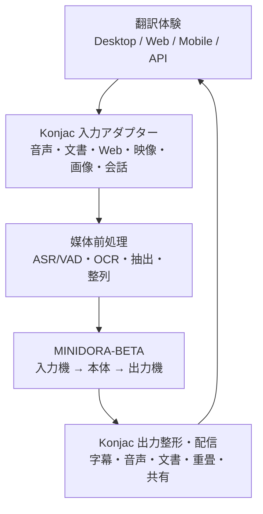
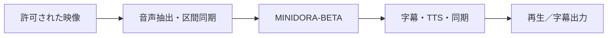

# こんにゃく翻訳 — ソフトウェア構成設計

- 制定：2026-11-04
- 対象：**翻訳製品の外側**。MINIDORA自身の再設計書ではない。
- 状態：提案仕様／未実装。実装時は実際の公開APIと照合する。

## 1. 全体構造

外側の **Konjac** は媒体と人間の体験を成立させる。内側の **MINIDORA-BETA** は決められた公開境界のとおりに入力を受け、駆動し、出力する。上流下流のいずれも**翻訳の意味判定・学習・最終採否の第二機構を作らない**。

横断機能：認証・同意・権限、翻訳セッション、ソースと結果の関係付け、保存と消去、監査、環境検査、負荷制御、性能測定。これらは別の意味エンジンではない。

## 2. 推奨パッケージ境界（将来実装の配置案）

| パッケージ候補 | 所有する責務 | 所有しない責務 |
|---|---|---|
| `apps/desktop` | Windows常駐、UI、OS権限連携、音声／画面選択、出力表示 | 翻訳の意味判定 |
| `apps/web` | 翻訳Web UI、ブラウザ許可、表示・編集・共有 | ブラウザ権限外の録音／OS強制介入 |
| `apps/mobile` | Android/iOS UI、会話・撮影・共有、権限処理 | 端末制約の迂回 |
| `services/gateway` | セッション、ジョブ受理、認証、制限、配送、明示された遠隔処理 | 任意の自動実行権限 |
| `packages/contracts` | 言語・話者・時刻・版を含む共通データ型・スキーマ | 自律的採否 |
| `packages/source-adapters` | Mic/system audio/file/camera/web/meeting/host appからの受理 | 他者の通信の無許可取得 |
| `packages/perception` | VAD、ASR、OCR、抽出、話者区別、分割、時間・領域座標 | 言語の意味を独自に翻訳 |
| `packages/translation-bridge` | MINIDORA-BETA公開I/Oに形式変換、能力照会、エラー伝搬、版固定 | 内側アルゴリズム、隠れた代替LLM |
| `packages/presentation` | テキスト、字幕、TTS、吹替、画像重畳、文書再構成 | 生成内容の黙った解釈変更 |
| `packages/sessions` | セッションごとの言語設定、同意、作業状態、元データへの参照 | 中核の学習状態の複製 |
| `packages/provenance` | 原文／訳文の対応、変更履歴、監査、テスト証拠 | 個人情報の無制限保持 |

パッケージ名は契約上の**候補**であり、空のディレクトリを大量作成して「実装完了」としない。言語やランタイムは **OS連携／処理特性／保守性／実測**で選び、単一言語に固定する原理はない。

## 3. 入口の共通化

1. 取り込み権限と対象の帰属・利用許可を確認。
2. 原媒体（`SourceAsset`）を参照し、形式・時刻基準・言語ヒント・話者候補・配置座標などの**非意味情報**を保管。
3. 入力形式ごとに抽出：音声→ASR/VAD、画像→OCR、動画→音声＋字幕トラック、文書→テキスト＋段落／表／図の対応、Web→DOM／選択範囲。
4. `TranslationRequest` に揃え、MINIDORA公開入力機へ渡す。内容を抽出できなければ原文保持のまま失敗／再試行／利用者修正を提示。
5. `TranslationResult` の出所と成否を検証し、確定状態に応じて表示へ配送。

ASR/OCRは**観測・記号化**の前処理。推測で原文を補い、翻訳済みとして確定させない。

## 4. 三つの代表経路

### A. 会話／同時字幕

- 暫定文字起こし・暫定訳・確定訳・中止を混同しない。
- ASR区間確定後に訳の確定可否を照合し、古い暫定イベントで確定表示を上書きしない。
- 相手の発話を翻訳音声で流す際、再生音のマイク再入力、音声衝突、話者混同を防ぐ。
- 遅延と字幕品質のトレードオフは計測し、未知なら即時性を保証しない。

### B. Web・PDF・文書

- DOM、段落、リンク、注、表、画像キャプションなどを翻訳元へ追跡可能とする。
- 文章だけ翻訳して配置破壊や注記喪失を正常終了とみなさない。
- レイアウト非対応の場合は安全な別表示へ明示的に切り替える。

### C. 動画・配信・吹替

- 時間軸の基準、途中シーク、話速、複数話者、字幕修正の版を管理。
- DRM・配信規約・著作権・画面取得制限を検知したら無許可回避しない。
- 動画自体のエンコード・吹替音声合成は出力機構。意味翻訳の別エンジンではない。

## 5. 共通イベント・状態管理

同一セッションで `source_asset_id`、`session_id`、`utterance_id`／`span_id`、`request_id`、`input_version`、`result_version` を追跡。リアルタイムでは `PROVISIONAL`／`FINAL` を表示状態として区分するが、**MINIDORA内部の採否結果と同一視しない**。

- 再処理は元入力の識別と版を保持。確定済みの訳を修正する場合は新しい版を作る。
- 一つの入力から複数言語への分岐は個々の出力先に対応する相関IDで管理。
- 出力先ごとの送信権限は独立。画面表示が許可されてもチャット送信やクラウド保存が許可されたとは限らない。
- 詳細は[境界契約](ENGINE_INTEGRATION.ja.md)。

## 6. 技術選定と実機前提

- **Windows優先**：デスクトップ、オーディオ装置・仮想音声、スクリーン、Web連携の受入を実機で確かめる。WSL/Linuxだけの成功は代用不可。
- **クロスプラットフォーム**：ブラウザ/Android/iOS/サーバーは同じ契約を利用するが、それぞれのOS・API・配信元権限に従う。
- **ローカルとリモート**：通信先、保存先、依存するモデル／サーバー／ネットワークを実際の処理前に表示できるようにする。自動クラウド流出は禁止。
- **入出力ツール**：RTranslator、Haas-ASR、speech.cppのモジュール境界を参考にするが、実装への採用は独立した実験・ライセンス監査後に確定。

## 7. 未解決（最初の実装で検証）

1. MINIDORA-BETAの公開契約で、指定元言語・複数訳先・継続文脈・短遅延処理を満たせるか。**未実証**。
2. ASR/OCR/TTSの端末別コスト、対応言語、語彙、レイテンシ、外部API要否。
3. Windows上の安全かつ合法な他アプリ音声取得と字幕重畳の手法。
4. 文書構造・動画時間軸・翻訳版の一貫性を測る受入指標。
5. モデル配布、ライセンス、端末容量、キャッシュ・権限・秘密管理。

未解決事項は仕様から消すのではなく、[工程](DELIVERY_PLAN.ja.md)の検証ゲートへ渡す。

